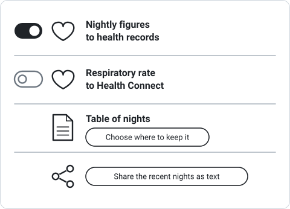
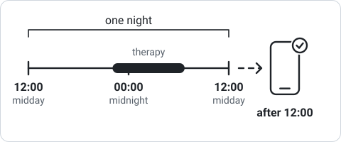

# PAPRelay

PAPRelay copies the data from a ResMed AirSense 11 CPAP machine to your Android phone.
It uses Bluetooth. It does not use the internet.


> [!IMPORTANT]
> - **Not from the manufacturer.** PAPRelay is an independent project. It is not made,
>   endorsed or supported by ResMed, the manufacturer of the machine, or by Google.
> - **For personal use only.** PAPRelay is made for one person: your own machine, your own
>   phone, your own data. It is not made for clinics, companies or care providers.
> - **Not a medical device.** Do not use PAPRelay to decide about diagnosis or treatment.
>   Values can be wrong, late or missing. Ask your doctor.
> - **No warranty.** You use PAPRelay at your own risk.

Based on SomnoTrace, originally created by Ilya Kruchinin (https://github.com/ilyakruchinin).

## What PAPRelay does

- It reads the nights that the machine has stored: hours of use, AHI, leak and pressure.
- It shows them on the phone, exactly as the machine recorded them.
- It can pass them on: to Health Connect, to a file, or to another app.
- It only reads. It cannot change the machine's settings, start or stop therapy, or
  delete data on the machine.
- It has no internet permission, no account, no advertising and no tracking.

## What you need

| | |
|---|---|
| Machine | ResMed AirSense 11. Tested with one AirSense 11 AutoSet, software `SW04600.19.8.8.0`. |
| Phone | Android 14 or later. Tested with one Pixel 10 Pro, Android 17. |
| For health records | Android 16 or later. |

PAPRelay trusts only the machine software that has been checked. With another software
version, PAPRelay says so and writes nothing. See
[how to help with a new version](CONTRIBUTING.md#a-new-machine-software-version).

The machine can be paired with one app only. **When you pair PAPRelay, the myAir app
loses its Bluetooth connection to the machine.**

## Get the app

There are two ways.

1. **Download it.** Take the newest `paprelay-….apk` from the
   [releases page](https://github.com/hahnfeld/paprelay/releases) and open it on the phone.
   Android asks you to allow the installation. The file is signed with a certificate whose
   SHA-256 fingerprint is
   `8E:1A:FB:37:FF:59:27:4A:5C:8D:C5:21:B8:0D:37:83:3C:0C:1F:0A:51:98:A7:D9:DF:5E:8D:AE:EC:F8:98:06`.
2. **Build it yourself.** See [Build it yourself](#build-it-yourself) below.

## First-time setup


1. In the **myAir** app, remove the machine. Also remove ("forget") the machine in the
   phone's Bluetooth settings.
2. On the machine, choose **More**, then **myAir App**, then **Connect**. The machine shows
   a code with four digits.
3. In PAPRelay, tap **Pair the machine**. Allow "Nearby devices" (this is Android's name
   for Bluetooth). Type the code. The code works for about two minutes.
4. Wait. PAPRelay tests every connection. A tick means that the connection works.
5. Go back and tap **Synchronise now**. After this, PAPRelay works by itself.

Keep the phone near the machine (a few metres) during setup.

## The home screen


The figures in this picture are examples.

## How to read the picture

The picture at the top of the home screen shows what is happening. You do not need to
read any text.


## Where the data goes

Open **Sharing** to choose.



- **Nightly figures to health records.** Health Connect has no special place for CPAP data.
  PAPRelay therefore stores each night there as *lab results* from "PAPRelay". Each record
  says that it is a nightly figure from a CPAP machine.
- **Respiratory rate.** Leave this off if a watch or a ring already writes your respiratory
  rate.
- **Table of nights.** One file, one line for each night, with the units in the column
  names. If you keep the file on a cloud drive, other programs can read it there.
- **Share.** Sends the recent nights as text to an app that you choose.

## When PAPRelay synchronises


It is normal that the phone is sometimes far from the machine. PAPRelay then waits and
tries again later. The machine keeps the recent nights, so PAPRelay catches up. Nothing is
written twice.

## When a night arrives



For the machine, one night runs from midday (12:00) to midday. The machine gives the
figures for a night only after that night has ended. So the figures for last night arrive
**in the afternoon**, not in the morning.

## If something does not work

| What you see | What to do |
|---|---|
| "The machine did not answer." | Move the phone near the machine. Check that Bluetooth is on. PAPRelay tries again by itself. |
| No machine is found during pairing. | Check that the machine is removed from myAir. Start again at step 2 of the setup. |
| "The machine no longer accepts this phone." | Open **Device check**, choose **Forget machine**, and pair again. |
| "PAPRelay cannot yet read this machine's software version." | This software version has not been checked yet. See [CONTRIBUTING.md](CONTRIBUTING.md#a-new-machine-software-version). |
| Last night is missing in the morning. | This is normal. The figures arrive after midday. |
| Health Connect shows nothing. | Open **Sharing** and check the switches. Open Health Connect and allow PAPRelay to write. |
| PAPRelay stops after some months. | Android pauses apps that you do not open. In the app settings, turn off the switch for unused apps. |

**Device check** tests every connection again and can save a report. The report holds no
pairing key, no full serial number and no Bluetooth address. Please attach it when you
[report a problem](https://github.com/hahnfeld/paprelay/issues).

## Privacy

- PAPRelay sends nothing over the internet. It cannot: it has no internet permission.
- Data leaves the app in three ways only: through Health Connect, through the file that you
  chose, and when you share it yourself.
- PAPRelay reads nothing from Health Connect. It asks only for permission to write.
- Uninstalling PAPRelay deletes everything that it stored itself.

## Build it yourself

You need a computer with **JDK 17 or later** and the **Android SDK**. The full
instructions, with every command, are in [docs/BUILDING.md](docs/BUILDING.md). In short:

```bash
git clone https://github.com/hahnfeld/paprelay.git
```

```bash
cd paprelay
```

Run the tests:

```bash
./gradlew :core:test :as11:test :app:testDebugUnitTest
```

Build the app, signed with your own key (see [docs/BUILDING.md](docs/BUILDING.md#4-make-your-own-signing-key) to make the key):

```bash
PAPRELAY_KEYSTORE="$HOME/paprelay-key.p12" PAPRELAY_KEYSTORE_PASSWORD="your password" ./gradlew :app:assembleRelease
```

Install it on a phone that is connected by USB:

```bash
adb install app/build/outputs/apk/release/app-release.apk
```

The *debug* build is a test version. It checks the connections but never synchronises.
To use the app, build the *release* version as shown above.

## More to read

| Document | What it is |
|---|---|
| [docs/BUILDING.md](docs/BUILDING.md) | How to build, test and install, step by step. |
| [docs/ARCHITECTURE.md](docs/ARCHITECTURE.md) | How the software is made, and why. |
| [CONTRIBUTING.md](CONTRIBUTING.md) | How to help, and the rules for changes. |
| [docs/INTENDED-USE.md](docs/INTENDED-USE.md) | What PAPRelay is for, and what it is not for. |
| [docs/DEVICE-CHECK.md](docs/DEVICE-CHECK.md) | What the device check tests. |
| [SECURITY.md](SECURITY.md) | How to report a security problem in private. |
| [CHANGELOG.md](CHANGELOG.md) | What changed in each version. |
| [docs/PORTING.md](docs/PORTING.md) | Which files come from SomnoTrace. |

## Licence

PAPRelay is free software under the GNU General Public License, version 3 or later, with
an attribution term inherited from SomnoTrace. See [LICENSE](LICENSE), [NOTICE](NOTICE) and
[THIRD-PARTY-NOTICES.md](THIRD-PARTY-NOTICES.md).

"For personal use only" describes what PAPRelay is made and tested for. It does not take
away any right that the licence gives you.

The Bluetooth method comes from [SomnoTrace](https://github.com/ilyakruchinin/somnotrace)
by Ilya Kruchinin. The layouts of the stored data were learned from the notes of the
[airbreak-plus](https://github.com/m-kozlowski/airbreak-plus) project.

ResMed, AirSense and myAir are trademarks of ResMed. Android and Health Connect are
trademarks of Google LLC. PAPRelay uses these names only to say what it works with.

## Thank you, OSCAR

PAPRelay exists because others showed that people can read the data of their own therapy.

**[OSCAR](https://www.sleepfiles.com/OSCAR/)**, the Open Source CPAP Analysis Reporter, and
SleepyHead before it, opened CPAP data to the people who sleep with these machines. For
many years, OSCAR has given everyone a free and detailed view of every night. PAPRelay's
decoding was checked against the same SD-card data that OSCAR reads.

If you want to *study* your nights (flow curves, every event, long-term charts), use
OSCAR. PAPRelay only moves the nightly figures to your phone.

- OSCAR: https://www.sleepfiles.com/OSCAR/
- OSCAR source code: https://gitlab.com/CrimsonNape/OSCAR-code
