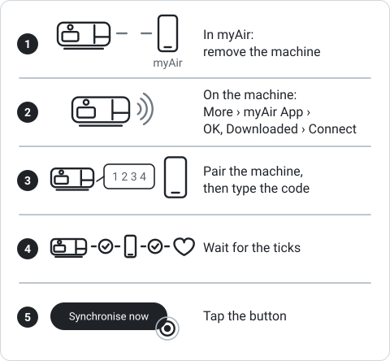
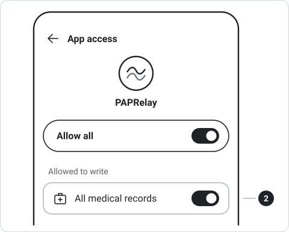
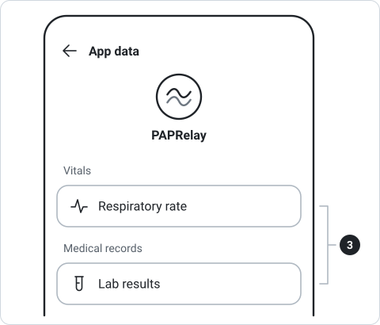
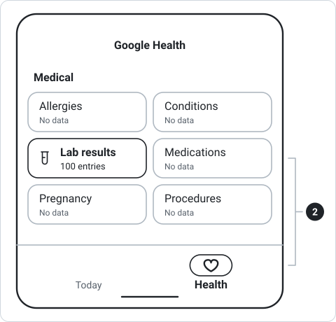

# PAPRelay

PAPRelay is an Android app that copies the data from a ResMed AirSense 11 CPAP machine to
your phone over Bluetooth. From the phone, it can send the data to Health Connect, to two
CSV files in a folder that you choose, or to another app.


> [!IMPORTANT]
> PAPRelay is an independent project. It is **not made, endorsed or supported by ResMed**
> (the maker of the machine) or by Google.
>
> PAPRelay is **for personal use only**: one person, with their own machine and their own
> phone. It is **not a medical device**. Values can be wrong, late or missing. Do not use
> them to make decisions about your treatment. Ask your doctor. There is no warranty.
> See [Intended use](docs/INTENDED-USE.md) for details.

## What it does

PAPRelay reads what the machine has stored for each night:

- hours of use, and the start and length of each session;
- AHI (the number of apnoeas and hypopnoeas for each hour of use) and the other indices;
- leak, pressure and breathing figures;
- humidifier, heated tube and blower figures;
- each breathing event: obstructive, central and unclassified apnoeas, and hypopnoeas.

The app shows the figures exactly as the machine recorded them, and can send them to other places (see
[Where the data goes](#where-the-data-goes)). It only reads from the machine: it cannot
change the settings, start or stop therapy, or delete data.

## What you need

- A ResMed AirSense 11.
- A phone with Android 14 or later. Health records in Health Connect need Android 16 or
  later.

The machine keeps one Bluetooth pairing at a time, so remove it from the myAir app before
you pair PAPRelay. To use myAir again, open **Device check** in PAPRelay and tap **Forget machine**, so that
PAPRelay stops connecting. Then pair myAir as usual.

## Get the app

On the phone, open the [releases page](https://github.com/hahnfeld/paprelay/releases),
download the newest file that ends in `.apk`, and open it. Android asks you to allow the
installation. You can also [build the app yourself](docs/BUILDING.md).

Official releases are signed with a certificate that has this SHA-256 fingerprint:

```
8e1afb37ff59274a5c8dc521b80d37833c0c1f0a5198a7d9df5e8daeecf89806
```

[Checking a downloaded release](docs/BUILDING.md#checking-a-downloaded-release) explains
how to compare a downloaded file with it.

## First-time setup

Keep the phone within a few metres of the machine during setup.



1. Remove the machine from the myAir app. If the phone's Bluetooth settings list the
   machine, tap **Forget** there. Closing the myAir app is not enough.
2. On the machine, choose **More**, then **myAir App**, then **OK, Downloaded**, then
   **Connect**. The machine shows its serial number and waits for the phone.
3. In PAPRelay, tap **Pair the machine**.
   - Allow **Nearby devices** (Bluetooth).
   - On Android 16 or later, also allow PAPRelay to write to Health Connect.
   - Tap **The machine shows its serial number**.
   - When the phone has connected, the machine shows a four-digit code. Type this code in
     PAPRelay within about two minutes.

   No code on the machine? Tap **Cancel** and start again at step 2.
4. Wait while PAPRelay tests each connection. The lines in the picture appear one by one,
   and a tick means that a connection works. A red cross means that it does not: see
   [If something does not work](#if-something-does-not-work).
5. Tap **Synchronise now**. After that, PAPRelay synchronises automatically.

## The home screen


1. The picture of the machine, the phone and Health Connect, with the two connections
   between them.
2. The newest night the machine has summed up: hours of use and AHI, then leak and
   pressure. Before the machine has summed up the night after it (it does this after the
   next midday), that night is shown above it, dated and marked **so far** (see the
   picture below and [The night so far](#nights-and-breathing-events)).
3. The result of the last synchronisation or, just after a device check, the result of
   the check.
4. The **Synchronise now** button.
5. The other pages:
   - **Nights** shows one night at a time, with all its figures.
   - **Breathing events** lists the events, newest first.
   - **Sharing** sets where the data goes.
   - **Device check** tests the connections and can save a report.
6. The **i** opens **About**.


The lines in the picture show the state of each connection:


- Two short lines: not set up yet.
- A grey line: set up and waiting.
- A dashed arrow: data is moving.
- A tick: it worked.
- A red cross on a line: it did not work.
- A red cross on the phone: the phone has a problem.

## Nights and breathing events

For the machine, a night runs from midday (12:00) to midday and has the date of the
evening. The machine sums a night up only after it has ended, because it can still change
the figures until then. This means that last night's figures arrive **in the afternoon**.
Before the machine has summed up a night (it does this after the next midday), PAPRelay
shows the night **so far**: the time of use and the breathing events (see below).


Open **Nights** to see one night at a time, newest first. Swipe, or tap the arrows beside
the date, to see an earlier or later night.


- The picture shows the night from midday to midday. A thick line is therapy. A tall mark
  is an apnoea, and a short mark is a hypopnoea.
- Below the picture are all the night's figures, in sections: use, events, leak,
  pressure, breathing, humidifier and tube, and the machine.
- A dash (—) means that the machine recorded no value. PAPRelay never shows a guessed
  zero.
- The machine's clock can be a few minutes wrong, so PAPRelay corrects times to the
  phone's clock. A time marked with * is by the machine's clock, because PAPRelay could
  not correct it.

**Breathing events** lists each event with its time and, for an apnoea, its length. For an
apnoea with a length, the time is when it ended. The machine records no length for a
hypopnoea, and its time can be its start or its end. To see the events of one night, tap the line with the
number of events on that night's page.

**The night so far.** Before the machine has summed up a night (it does this after the
next midday), the home screen shows that night, dated and marked "so far", above the
newest night the machine has summed up: how long the mask was on and how many breathing
events the machine had logged when it was last read. A session that had not ended then is
shown with that time ("mask still on at 07:30"). This is a count, not a rate: PAPRelay works out
no AHI or other figure. Where a record of the machine's log could not be read, no time of
use is given. **Nights** shows the same as the newest page, marked "so far", with the
picture of the night, and **Breathing events** lists that night's events first. After
midday, at the next synchronisation, the machine's own night takes its place. What is shown "so far" stays in the app:
it is not written to the files, to Health Connect or to the shared text. The time of use
comes from the machine's log of mask on and mask off, which was checked against the
machine's own nightly sessions.

## When it synchronises


If the phone is away from the machine, PAPRelay tries again later. The machine keeps its
recent nights, so PAPRelay copies any missing nights the next time it reaches the machine.

The first synchronisation copies up to 400 days of data from the machine.

Before the machine has summed up a night (it does this after the next midday), a
synchronisation brings the night so far: the time of use and the breathing events.
Respiratory rate, if it is switched on, goes to Health Connect as before. After midday, at
the next synchronisation, the machine's own night replaces the night so far.

## Where the data goes

Open **Sharing** to choose where the data goes.


- **Nightly figures to health records** (on at first). PAPRelay writes usage, AHI, leak,
  pressure and breathing for each night to the health records in Health Connect. Health
  Connect has no place for CPAP data, so the nights appear under lab results, from
  "PAPRelay (CPAP machine)". They are not laboratory results. The breathing events and the
  figures that describe the machine (humidifier, heated tube, blower) go only to the two
  files.
- **Name and date of birth** (not added at first), below the health records. Google Health
  shows these records only when they belong to a person with a name and a date of birth.
  Tap the row, type your given names and family name, choose your date of birth, and tap
  **Save**. PAPRelay then writes one patient record with them to the health records, and
  every nightly record names it. **Remove** deletes them from the phone. When **Nightly figures
  to health records** is switched on, PAPRelay then writes the nightly records again without
  them, and deletes the patient record. Forgetting the machine does not delete them.
- **Respiratory rate to Health Connect** (off at first). One value for each minute of
  therapy. Leave it off if a watch or a ring already writes your respiratory rate. On
  machine software 19.8.8.0, it starts once the machine holds a session of 30 minutes or
  more. After a software change, this session must be one recorded after the change.
  On other software versions, it waits for a session of one hour or more, and the app
  says that it is waiting. It waits again after the machine's software changes, or after
  you install PAPRelay again. On these versions, respiratory rate recorded before you
  switched it on, before the software changed, or before you installed PAPRelay again is
  not written.
- **Files of nights and events**. The two files, kept up to date in a folder that you
  choose once, for example on a cloud drive. See [The two files](#the-two-files).
- **Share the recent nights as text**. Sends the recent nights as text to an app that you
  choose.

### See the records in Health Connect

PAPRelay only writes to Health Connect. To see what it wrote, open Health Connect itself.
The names below are from Health Connect on Android 16. Some phones use other names.

1. Open the phone's **Settings** and search for "Health Connect". On a Pixel phone, it is in
   **Settings › Security and privacy › Privacy controls › Health Connect**.
2. Tap **App permissions**, then **PAPRelay**. On the **App access** screen, check that
   **All medical records** is switched on. If **Respiratory rate to Health Connect** is on in PAPRelay, check that
   respiratory rate is allowed too.

   

3. Go back to the main screen of Health Connect. Tap **App data**, then **PAPRelay**. On some
   phones, this is under **Data and access**. Respiratory rate is under **Vitals**, if it is
   switched on in PAPRelay. The nightly figures are under **Medical records › Lab
   results**.

   

4. Tap **Lab results**. The list has up to five entries for each night: usage, AHI, leak,
   pressure and breathing. Each entry shows the date of the night, "PAPRelay (CPAP
   machine)" and a title, for example "CPAP therapy usage in the night (hours)". Tap an
   entry to see its value.

   

The nightly figures are filed under lab results because Health Connect has no other place
for them. They are not laboratory results (see [Intended use](docs/INTENDED-USE.md)).

To see the records in the Google Health app, read the next section.

### See the records in Google Health

Google Health shows the records only when they name a person with a name and a date of
birth.

1. In PAPRelay, open **Sharing**, tap **Name and date of birth**, and add your name and date
   of birth. [Where the data goes](#where-the-data-goes) explains what this does, and
   [Privacy](#privacy) gives its limits. If **Nightly figures to health records** is on, tap
   **Synchronise now** on the home screen. PAPRelay then writes the records again with your
   name.
2. Open Google Health. Tap **Health**, then under **Medical** tap **Lab results**.

   

3. Tap **PAPRelay (CPAP machine)** to show only PAPRelay's records. Each card is one
   figure, with its latest value and the number of nights that have it ("30 results").

   

4. Tap a card to see that figure for every night, newest first.

   

Each record shows at 12:00 PM on its date. This is because a night runs from midday to
midday and has the date of the evening (see
[Nights and breathing events](#nights-and-breathing-events)). A night without therapy shows
a usage of 0 h.

Google Health shows only the main value of each record. The other values, such as the parts
of the AHI, are in the same record, but Google Health does not show them. They are also in
[the two files](#the-two-files).

Google Health lists the records under lab results for the same reason as Health Connect
(see [See the records in Health Connect](#see-the-records-in-health-connect)).

### The two files

PAPRelay writes two CSV files in the folder, and does not change any other file there.
When the data changes, PAPRelay writes both files again in full. Each file has one header line,
the units are in the column names, and the newest line comes first. An empty cell means
that the machine recorded no value.

- `paprelay_nights.csv` has one line for each finished night: the date, hours of use, the
  number of sessions, every figure (AHI and the other indices, leak, pressure, breathing,
  humidifier, heated tube and blower), and the start and length of each session. Session
  starts appear twice: corrected to the phone's clock, and by the machine's clock. Leak and
  the other flows are in litres per minute, and tidal volume is in millilitres.
- `paprelay_events.csv` has one line for each breathing event of the finished nights
  (obstructive apnoea, central apnoea, unclassified apnoea or hypopnoea). Each line gives
  the event's night, its time corrected to the phone's clock, its time by the machine's
  clock, what that time means (`time_is`), and its length. For an apnoea with a length,
  the time is when it ended (`end`). The machine records no length for a hypopnoea, and
  its time can be its start or its end (`start_or_end`). The events of the current day are
  added when that night has ended.

A corrected time is empty when PAPRelay cannot correct it with confidence: when the event
is more than a week older than the synchronisation that first copied it, or when the
machine's clock was changed just before. The machine's own time is always there.

To open the files in a spreadsheet: cells are separated by commas, and decimals use a full
stop. Times are in ISO 8601 with their offset from UTC, for example
`2026-11-14T23:05:00-07:00`. A night's session starts and lengths are lists in one cell,
separated by spaces. If your spreadsheet uses commas for decimals, import the file as CSV
with "." as the decimal separator.

Upgrading from 0.2? PAPRelay 0.3.0 and later do not use the file chosen in an earlier
version. Choose a folder on the **Sharing** page.

## If something does not work

| What you see | What to do |
|---|---|
| "The machine did not answer." | Move the phone near the machine and check that Bluetooth is on. PAPRelay tries again automatically. |
| No machine is found during pairing. | Check that the machine is waiting for the phone (setup step 2). If it is, remove the machine from the myAir app, and tap **Forget** for it in the phone's Bluetooth settings. Then start again at step 2 of the setup. |
| "The machine no longer accepts this phone." | Open **Device check**, tap **Forget machine**, and pair again. |
| "PAPRelay cannot yet read this machine's software." | PAPRelay does not know this machine's software version yet. Please [report it](CONTRIBUTING.md#machines-and-software-versions). |
| Last night shows only "so far". | This is normal before midday. The machine adds its own figures after midday, and the next synchronisation brings them. |
| "Not every night has been copied yet." for several days, or "PAPRelay could not read some of the data from the machine." | Open **Device check**, tap **Run device check**, then **Save report**, and [report the problem](https://github.com/hahnfeld/paprelay/issues). |
| Health Connect shows nothing. | Open **Sharing** and check the switches. In Health Connect, allow PAPRelay to write (see [See the records in Health Connect](#see-the-records-in-health-connect)). Phones with Android 14 or 15 have no health records. |
| "Respiratory rate starts after a night of therapy of one hour or more" is still shown after several nights. | PAPRelay cannot yet read respiratory rate from this machine's software. Switch it off in **Sharing**, and please [report it](CONTRIBUTING.md#machines-and-software-versions). The nightly figures are not affected. |
| **Breathing events** is empty. | Events appear after the next synchronisation. If the list is still empty after a night of therapy, open **Device check**, tap **Run device check**, then **Save report**, and [report it](https://github.com/hahnfeld/paprelay/issues). |
| The two files are not in the folder. | Open **Sharing**. If it says that PAPRelay could not write the files, choose the folder again. The files appear after the first finished night. |
| PAPRelay stops synchronising after some months. | Android pauses apps that you do not open. In the app settings for PAPRelay, turn off **Manage app if unused** or **Pause app activity if unused** (the name depends on the phone). |

The device-check report is safe to share: it contains no pairing key, no full serial
number and no Bluetooth address. Please attach it when you
[report a problem](https://github.com/hahnfeld/paprelay/issues).

## Privacy

PAPRelay has no internet access, no accounts, no analytics and no advertising. Data leaves
the app only:

- through Health Connect;
- through the two files in the folder that you chose (if the folder is on a cloud drive,
  the drive's own app uploads them);
- in a device-check report that you save;
- when you share it yourself.

The night so far never leaves the app.

Your name and date of birth, if you add them, are kept encrypted with a key in the phone's
secure hardware, and are never in the two files, the shared text, the device-check report
or a log. Two limits apply:

- Once PAPRelay has written them to Health Connect, Health Connect stores them, and any app
  that you allow to read health records can read them.
- On a phone that its owner has rooted or unlocked, the app's storage is not protected
  (see [SECURITY.md](SECURITY.md)).

PAPRelay only writes to Health Connect and never reads from it. Uninstalling PAPRelay
deletes everything it stored itself. The two files and the health records stay until you
delete them.

## For developers

- [docs/BUILDING.md](docs/BUILDING.md): build, test and install.
- [docs/ARCHITECTURE.md](docs/ARCHITECTURE.md): how the software is built, and why.
- [CONTRIBUTING.md](CONTRIBUTING.md): how to help, and the rules for changes.
- [docs/INTENDED-USE.md](docs/INTENDED-USE.md): what PAPRelay is for.
- [docs/DEVICE-CHECK.md](docs/DEVICE-CHECK.md): what the device check tests.
- [SECURITY.md](SECURITY.md), [CODE_OF_CONDUCT.md](CODE_OF_CONDUCT.md), [CHANGELOG.md](CHANGELOG.md).

## Licence

Based on SomnoTrace, originally created by Ilya Kruchinin (https://github.com/ilyakruchinin).

PAPRelay is free software under the GNU General Public License, version 3 or later, with
an attribution term inherited from SomnoTrace. See [LICENSE](LICENSE), [NOTICE](NOTICE) and
[THIRD-PARTY-NOTICES.md](THIRD-PARTY-NOTICES.md).

"For personal use only" describes what PAPRelay is made and tested for. It does not limit
your rights under the licence.

ResMed, AirSense and myAir are trademarks of ResMed. Android and Health Connect are
trademarks of Google LLC. All other names belong to their owners. PAPRelay uses these names
only to say what it works with.

## Thanks to OSCAR

[OSCAR](https://www.sleepfiles.com/OSCAR/), the Open Source CPAP Analysis Reporter, and
SleepyHead before it, first made CPAP data readable for the people who use these machines.
PAPRelay's decoding was checked against the SD-card data that OSCAR reads.

PAPRelay copies the nightly figures and the breathing events to your phone. To study your
nights in detail, use OSCAR. Its source code is at https://gitlab.com/CrimsonNape/OSCAR-code.
