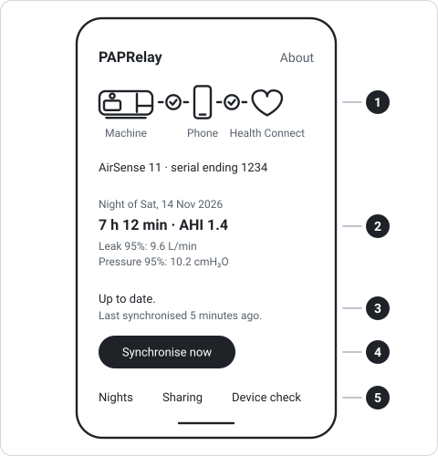

# PAPRelay

PAPRelay copies the data from a ResMed AirSense 11 CPAP machine to your Android phone.
It uses Bluetooth. It does not use the internet.

> [!IMPORTANT]
> PAPRelay is an independent project. It is **not made, endorsed or supported by ResMed**
> (the manufacturer of the machine) or by Google.
>
> PAPRelay is **for personal use only**: one person, with their own machine and their own phone.
>
> PAPRelay is **not a medical device**. Values can be wrong, late or missing. Do not use it
> to decide about treatment. Ask your doctor.
>
> There is no warranty.

## What it does

- It reads the nights that the machine has stored: hours of use, AHI (breathing events
  for each hour of use), leak and pressure.
- It shows them on the phone as the machine recorded them, and can pass them on to
  Health Connect, to a file, or to another app.
- It cannot change the machine's settings, start or stop therapy, or delete data on the
  machine.

## What you need

- A ResMed AirSense 11.
- A phone with Android 14 or later. Health records need Android 16 or later.

The machine seems to keep one pairing only. **When you pair PAPRelay, expect the myAir app
to lose its connection to the machine.** If you pair myAir again later, expect PAPRelay to
lose its connection. Then pair PAPRelay again.

## Get the app

On the phone, open the [releases page](https://github.com/hahnfeld/paprelay/releases),
download the newest file that ends in `.apk`, and open it. Android asks you to allow the
installation.

You can also [build it yourself](docs/BUILDING.md).

## First-time setup

Keep the phone within a few metres of the machine.

1. In the myAir app, remove the machine. If the phone's Bluetooth settings list the
   machine, remove ("forget") it there too.
2. On the machine, choose **More**, then **myAir App**, then **Connect**. The machine now
   waits for the phone.
3. In PAPRelay, tap **Pair the machine**. Allow "Nearby devices"; this is Android's name
   for Bluetooth. On Android 16 or later, Android then asks if PAPRelay may write to Health
   Connect. Allow this too. The machine shows a code with four digits. Type the code in
   PAPRelay. The code works for about two minutes.
4. Wait. PAPRelay tests every connection. A tick means that the connection works.
5. Tap **Synchronise now**. After this, PAPRelay synchronises by itself.

## The home screen

1. The picture shows the machine, the phone and Health Connect, and the two connections
   between them.
2. Last night: hours of use and AHI, then leak and pressure.
3. What happened the last time PAPRelay synchronised.
4. Tap to synchronise now.
5. **Nights** lists every night. **Sharing** sets where the data goes. **Device check**
   tests the connections again.

The figures in this picture are examples.

The lines in the picture change:

- Two short lines: not set up yet.
- A grey line: set up and waiting.
- A dashed arrow: data is moving.
- A tick: it worked.
- A red cross on a line: it did not work.
- A red cross on the phone: the phone has a problem.

## Where the data goes

Open **Sharing** to choose.

- Nightly figures to health records: on at the start. Health Connect has no place for
  CPAP data, so the nights appear there under lab results, from "PAPRelay (CPAP machine)".
  They are not laboratory results.
- Respiratory rate: off at the start. It is one value for each minute of therapy. Leave it
  off if a watch or a ring already writes your respiratory rate. For now PAPRelay reads it
  from machine software 19.8.8.0 only; the page tells you if your machine has another.
- Table of nights: one file (CSV) with one line for each night. You choose where it is
  kept, for example on a cloud drive.
- Share: sends the recent nights as text to an app that you choose.

## When it synchronises

When the phone is away from the machine, PAPRelay waits and tries again later. The machine
keeps the recent nights, so PAPRelay copies the missing nights then.

## When a night arrives

For the machine, one night runs from midday (12:00) to midday. PAPRelay shows a night
only after it has ended. Until then the machine can still change the figures. So last
night's figures arrive **in the afternoon**, not in the morning.

## If something does not work

| What you see | What to do |
|---|---|
| "The machine did not answer." | Move the phone near the machine. Check that Bluetooth is on. PAPRelay tries again by itself. |
| No machine is found during pairing. | Check that the machine is removed from myAir. Start again at step 2 of the setup. |
| "The machine no longer accepts this phone." | Open **Device check**, choose **Forget machine**, and pair again. |
| "PAPRelay cannot yet read this machine's software." | PAPRelay reads the AirSense 11 only. If your machine is an AirSense 11, please [report it](CONTRIBUTING.md#machines-and-software-versions). |
| Last night is missing in the morning. | This is normal. The figures arrive after midday. |
| "Not every night has been copied yet." for several days, or "PAPRelay could not read some of the data from the machine." | Open **Device check**, run it, save the report, and [report the problem](https://github.com/hahnfeld/paprelay/issues). |
| Health Connect shows nothing. | Open **Sharing** and check the switches. In Health Connect, allow PAPRelay to write. Phones with Android 14 or 15 have no health records. |
| PAPRelay stops after some months. | Android pauses apps that you do not open. In the app settings, turn off the switch for unused apps. |

**Device check** can save a report. The report is safe to share: it holds no pairing key,
no full serial number and no Bluetooth address. Please attach it when you
[report a problem](https://github.com/hahnfeld/paprelay/issues).

## Privacy

- PAPRelay has no internet permission. It cannot send anything over the internet.
- Data leaves the app in three ways only: through Health Connect, through the file that you
  chose, and when you share it yourself.
- PAPRelay reads nothing from Health Connect.
- Uninstalling PAPRelay deletes what it stored itself. The table of nights and the records
  in Health Connect stay until you delete them.

## For developers

- [docs/BUILDING.md](docs/BUILDING.md): build, test and install.
- [docs/ARCHITECTURE.md](docs/ARCHITECTURE.md): how the software is made, and why.
- [CONTRIBUTING.md](CONTRIBUTING.md): how to help, and the rules for changes.
- [docs/INTENDED-USE.md](docs/INTENDED-USE.md): what PAPRelay is for.
- [docs/DEVICE-CHECK.md](docs/DEVICE-CHECK.md): what the device check tests.
- [SECURITY.md](SECURITY.md), [CODE_OF_CONDUCT.md](CODE_OF_CONDUCT.md), [CHANGELOG.md](CHANGELOG.md).

## Licence

Based on SomnoTrace, originally created by Ilya Kruchinin (https://github.com/ilyakruchinin).

PAPRelay is free software under the GNU General Public License, version 3 or later, with
an attribution term inherited from SomnoTrace. See [LICENSE](LICENSE), [NOTICE](NOTICE) and
[THIRD-PARTY-NOTICES.md](THIRD-PARTY-NOTICES.md).

"For personal use only" says what PAPRelay is made and tested for. It does not take away
any right that the licence gives you.

ResMed, AirSense and myAir are trademarks of ResMed. Android and Health Connect
are trademarks of Google LLC. All other names belong to their owners. PAPRelay uses these
names only to say what it works with.

## Thanks to OSCAR

[OSCAR](https://www.sleepfiles.com/OSCAR/), the Open Source CPAP Analysis Reporter, and
SleepyHead before it, first made CPAP data readable for the people who use these machines.
PAPRelay's decoding was checked against the SD-card data that OSCAR reads.

To study your nights in detail, use OSCAR. PAPRelay only copies the nightly figures to
your phone. OSCAR's source code is at https://gitlab.com/CrimsonNape/OSCAR-code.
