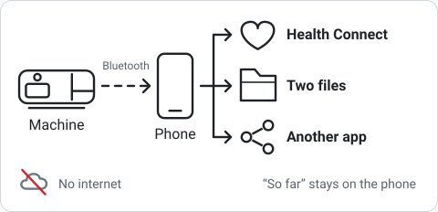
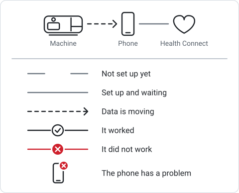
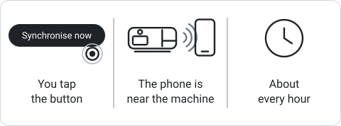
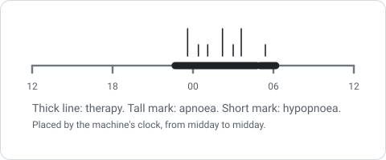

# PAPRelay

PAPRelay copies the data from a ResMed AirSense 11 CPAP machine to your Android phone.
It uses Bluetooth. It does not use the internet.

> [!IMPORTANT]
> PAPRelay is an independent project. It is **not made, endorsed or supported by ResMed**
> (the manufacturer of the machine) or by Google.
>
> PAPRelay is **for personal use only**: one person, with their own machine and their own phone.
>
> PAPRelay is **not a medical device**. Values can be wrong, late or missing. Do not use it
> to decide about treatment. Ask your doctor.
>
> There is no warranty.

## What it does

- It reads the nights that the machine has stored: hours of use, AHI (breathing events
  for each hour of use), leak, pressure, breathing and humidifier figures, and the list
  of breathing events.
- It shows them on the phone as the machine recorded them, and can pass them on to
  Health Connect, to two files in a folder that you choose, or to another app.
- It cannot change the machine's settings, start or stop therapy, or delete data on the
  machine.

## What you need

- A ResMed AirSense 11.
- A phone with Android 14 or later. Health records need Android 16 or later.

The machine seems to keep one pairing only. **When you pair PAPRelay, expect the myAir app
to lose its connection to the machine.** If you pair myAir again later, expect PAPRelay to
lose its connection. Then pair PAPRelay again.

## Get the app

On the phone, open the [releases page](https://github.com/hahnfeld/paprelay/releases),
download the newest file that ends in `.apk`, and open it. Android asks you to allow the
installation.

You can also [build it yourself](docs/BUILDING.md).

## First-time setup

Keep the phone within a few metres of the machine.

1. Remove the machine from the myAir app. If the phone's Bluetooth settings list the
   machine, remove ("forget") it there too.
2. On the machine, choose **More**, then **myAir App**, then **Connect**. The machine now waits for
   the phone.
3. In PAPRelay, tap **Pair the machine**. PAPRelay shows these steps again. When the machine
   shows a code with four digits, tap **The machine shows a code**. Allow "Nearby devices";
   this is Android's name for Bluetooth. On Android 16 or later, Android then asks if
   PAPRelay may write to Health Connect. Allow this too. Type the code in PAPRelay. The code
   works for about two minutes. If the machine shows no code, tap **Cancel** and start
   again at step 2.
4. Wait. PAPRelay tests every connection. The lines in the picture fill in one after the
   other. A tick means that the connection works.
5. Tap **Synchronise now**. After this, PAPRelay synchronises by itself.

## The home screen

1. The picture shows the machine, the phone and Health Connect, and the two connections
   between them.
2. Last night: hours of use and AHI, then leak and pressure.
3. What happened the last time PAPRelay synchronised. Just after a device check, what the
   check found.
4. Tap to synchronise now.
5. **Nights** shows one night at a time, with all its figures. Swipe, or tap the arrows, to
   see an earlier or later night. **Breathing events** lists the events, newest first.
   **Sharing** sets where the data goes. **Device check** tests the connections and saves
   a report.
6. The **i** opens About.

The figures in this picture are examples.

The lines in the picture change:

- Two short lines: not set up yet.
- A grey line: set up and waiting.
- A dashed arrow: data is moving.
- A tick: it worked.
- A red cross on a line: it did not work.
- A red cross on the phone: the phone has a problem.

## Where the data goes

Open **Sharing** to choose.

- Nightly figures to health records: on at the start. Health Connect has no place for
  CPAP data, so the nights appear there under lab results, from "PAPRelay (CPAP machine)".
  They are not laboratory results. The breathing events, and the figures that describe
  the machine (humidifier, heated tube, blower), are not written there. They are in the
  two files.
- Respiratory rate: off at the start. It is one value for each minute of therapy. Leave it
  off if a watch or a ring already writes your respiratory rate. With machine
  software other than version 19.8.8.0, respiratory rate starts with the first night of an
  hour or more after you first switch it on, after the machine's software changes, or
  after PAPRelay was installed again. Earlier nights are not written. Until then the app says that it waits.
- Files of nights and events: two files (CSV), kept up to date in a folder that you choose
  once, for example on a cloud drive. See [The two files](#the-two-files).
- Share: sends the recent nights as text to an app that you choose. Sharing is only on
  this page.

### The two files

PAPRelay writes these two files in the folder, and touches nothing else there. Each run
writes them again whole. Each file has one header line, and the units are in the column
names. An empty cell means that the machine recorded no value. It is never a guessed zero.
The newest line is first.

- `paprelay_nights.csv` has one line for each finished night: the date, hours of use, the
  number of sessions, every figure (AHI and its parts, leak, pressure, breathing,
  humidifier, heated tube and blower), and each session's start and length. Session
  starts are given twice: corrected to the phone's clock, and by the machine's clock.
  Leak and the other flows are in litres per minute, tidal volume in millilitres.
- `paprelay_events.csv` has one line for each breathing event (obstructive apnoea, central
  apnoea, unclassified apnoea, hypopnoea) of the finished nights: its night, its time
  corrected to the phone's clock, its time by the machine's clock, what that time is
  (`time_is`), and its length. The time of an apnoea with a length is when it ended
(`end`). The
  machine records no length for a hypopnoea. Its time can be its start or its end
  (`start_or_end`). The events of the day still running are added when that night is
  finished.

A corrected time is empty when PAPRelay cannot correct it with confidence: the event is
more than a week older than the synchronisation that first copied it, or the machine's
clock was changed just before. The machine's own time is always there.

For a spreadsheet: the files use commas between cells and a full stop for decimals. Times
are in ISO 8601 with their offset from UTC, for example `2026-11-14T23:05:00-07:00`. A
night's session starts and lengths are lists in one cell, separated by spaces. If your
spreadsheet uses commas for decimals, import the file as CSV with "." as the decimal
separator.

PAPRelay 0.3.0 and later do not use a file chosen in an earlier version. Choose a folder
on the **Sharing** page.

## When it synchronises

When the phone is away from the machine, PAPRelay waits and tries again later. The machine
keeps the recent nights, so PAPRelay copies the missing nights then.

## When a night arrives

For the machine, one night runs from midday (12:00) to midday. PAPRelay shows a night
only after it has ended. Until then the machine can still change the figures. So last
night's figures arrive **in the afternoon**, not in the morning.

## A night, and its events

Open **Nights**. The newest night is shown first. Swipe, or tap the arrows beside the date,
to see an earlier or later night.

- The picture shows the night from midday to midday. A thick line is therapy. A tall mark
  is an apnoea, a short mark a hypopnoea.
- Below it are all the night's figures, in sections: use, events, leak, pressure,
  breathing, humidifier and tube, and the machine.
- A dash (—) means that the machine recorded no value. PAPRelay never shows a guessed zero.
- Times are corrected to the phone's clock. A time with * is by the machine's clock,
  because PAPRelay could not correct it.

**Breathing events** lists each event with its time and, for an apnoea, its length. The
time of an apnoea with a length is when it ended. The machine records no length for a hypopnoea. Its
time can be its start or its end. From a night, tap the line with the number of events to see that
night's events.

The first synchronisation reads the last 400 days that the machine still holds, with all
their figures and events.

## If something does not work

| What you see | What to do |
|---|---|
| "The machine did not answer." | Move the phone near the machine. Check that Bluetooth is on. PAPRelay tries again by itself. |
| No machine is found during pairing. | Check that the machine is removed from myAir. Start again at step 2 of the setup. |
| "The machine no longer accepts this phone." | Open **Device check**, choose **Forget machine**, and pair again. |
| "PAPRelay cannot yet read this machine's software." | PAPRelay does not know the software of this machine. Please [report it](CONTRIBUTING.md#machines-and-software-versions). |
| Last night is missing in the morning. | This is normal. The figures arrive after midday. |
| "Not every night has been copied yet." for several days, or "PAPRelay could not read some of the data from the machine." | Open **Device check**, run it, save the report, and [report the problem](https://github.com/hahnfeld/paprelay/issues). |
| Health Connect shows nothing. | Open **Sharing** and check the switches. In Health Connect, allow PAPRelay to write. Phones with Android 14 or 15 have no health records. |
| "Respiratory rate starts after a night of therapy of one hour or more" stays after several nights. | PAPRelay cannot read respiratory rate from this machine's software yet. Switch it off in **Sharing**, and please [report it](CONTRIBUTING.md#machines-and-software-versions). The nightly figures are not affected. |
| **Breathing events** is empty. | Events appear after the next synchronisation. If the list stays empty after a night of therapy, run **Device check**, save the report, and [report it](https://github.com/hahnfeld/paprelay/issues). |
| The files of nights and events are not in the folder. | Open **Sharing**. If it says that the files could not be written, choose the folder again. The files appear after the first finished night. |
| PAPRelay stops after some months. | Android pauses apps that you do not open. In the app settings, turn off the switch for unused apps. |

**Device check** can save a report. The report is safe to share: it holds no pairing key,
no full serial number and no Bluetooth address. Please attach it when you
[report a problem](https://github.com/hahnfeld/paprelay/issues).

## Privacy

- PAPRelay has no internet permission. It cannot send anything over the internet.
- Data leaves the app in four ways only: through Health Connect, through the two files in
  the folder that you chose, through a device-check report that you save, and when you
  share it yourself.
- PAPRelay reads nothing from Health Connect.
- Uninstalling PAPRelay deletes what it stored itself. The two files in your folder and the
  records in Health Connect stay until you delete them.

## For developers

- [docs/BUILDING.md](docs/BUILDING.md): build, test and install.
- [docs/ARCHITECTURE.md](docs/ARCHITECTURE.md): how the software is made, and why.
- [CONTRIBUTING.md](CONTRIBUTING.md): how to help, and the rules for changes.
- [docs/INTENDED-USE.md](docs/INTENDED-USE.md): what PAPRelay is for.
- [docs/DEVICE-CHECK.md](docs/DEVICE-CHECK.md): what the device check tests.
- [SECURITY.md](SECURITY.md), [CODE_OF_CONDUCT.md](CODE_OF_CONDUCT.md), [CHANGELOG.md](CHANGELOG.md).

## Licence

Based on SomnoTrace, originally created by Ilya Kruchinin (https://github.com/ilyakruchinin).

PAPRelay is free software under the GNU General Public License, version 3 or later, with
an attribution term inherited from SomnoTrace. See [LICENSE](LICENSE), [NOTICE](NOTICE) and
[THIRD-PARTY-NOTICES.md](THIRD-PARTY-NOTICES.md).

"For personal use only" says what PAPRelay is made and tested for. It does not take away
any right that the licence gives you.

ResMed, AirSense and myAir are trademarks of ResMed. Android and Health Connect
are trademarks of Google LLC. All other names belong to their owners. PAPRelay uses these
names only to say what it works with.

## Thanks to OSCAR

[OSCAR](https://www.sleepfiles.com/OSCAR/), the Open Source CPAP Analysis Reporter, and
SleepyHead before it, first made CPAP data readable for the people who use these machines.
PAPRelay's decoding was checked against the SD-card data that OSCAR reads.

To study your nights in detail, use OSCAR. PAPRelay only copies the nightly figures and
the breathing events to your phone. OSCAR's source code is at https://gitlab.com/CrimsonNape/OSCAR-code.
