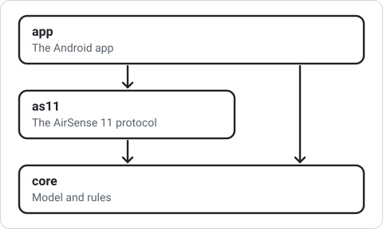
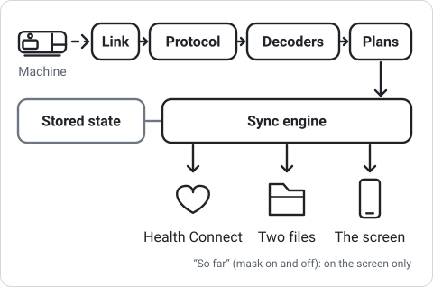

# Architecture

Read this before you change the code.

PAPRelay copies what a ResMed AirSense 11 has recorded to the phone and passes it on
unchanged. A figure is passed on as the machine stored it, or not at all. Being out of
range, a lost connection, a crash or a reinstall must not lose a night, write one twice,
or leave a wrong value behind.

## Modules

| Module | Kind | Contents |
|---|---|---|
| `core` | Kotlin/JVM | Measurements with their units, the machine's clock, a night and its records, the ledger rules. No Android, no Bluetooth. |
| `as11` | Kotlin/JVM | The AirSense 11 protocol: framing, pairing, the encrypted session, the request set, downloads, the decoders of the stored logs, and the plans that turn decoded records into what is passed on. Its test fixtures hold a simulated machine. |
| `app` | Android | Bluetooth, the stored pairing, Health Connect, the sync engine with its stores and background runs, and the screens. |

`core` and `as11` build and test without the Android SDK (`-Ppaprelay.skipAndroid=true`).
Most of the logic that can be wrong is there, or behind interfaces that the tests replace.

## How the data flows

| Step | Where | What happens |
|---|---|---|
| Link | `app/ble/GattLink`, `GattOperations` | One Bluetooth (GATT) connection as a byte pipe. One request in flight at a time, each matched to its own completion. A connection is never reused. |
| Protocol | `as11/As11Client`, `Fig`, `Srp6a`, `SessionCrypto`, `As11Request` | Frames with two checksums. SRP-6a pairing with the code from the machine's screen. An AES session that the machine must prove. Downloads in rounds, each verified by its SHA-256. |
| Decoders | `as11/decode` | Turn the downloaded bytes into records. Layouts and scale factors are in one file, `As11Scales`. |
| Plans | `as11/plan` | `NightPlan` turns one daily summary into a `Night`. `RespiratoryRatePlan` turns one per-minute record into readings. |
| Sync engine | `app/sync/SyncEngine` | Decides what to download, what is new or changed, and what to write. Handles every failure case. |
| Outputs | `app/hc`, `app/sync/HealthConnectSink`, `NightFile`, `app/ui` | Health records and respiratory rate in Health Connect, the table of nights in a file, and the screens. |
| Stored state | `app/pairing`, `app/sync/SyncStore`, `NightStore` | See [Stored state](#stored-state). |

PAPRelay can request four of the machine's stored logs:

| Log | Holds | Used by |
|---|---|---|
| `Summary` | One record for each day, midday to midday: usage, indices, percentiles | The sync engine, for the nightly figures |
| `TherapyOneMinutePeriodic` | One sample for each minute of therapy | The sync engine, for respiratory rate |
| `UsageEvents-TherapyStatusEvents` | Mask on and off | The device check only (downloaded and verified) |
| `TherapyEvents-RespiratoryEvents` | Each breathing event | The device check only (downloaded and verified) |

PAPRelay passes on a day's summary only after that day has ended, at midday by the
machine's clock. This is why a night's figures arrive in the afternoon.

## Design decisions

### A closed request set

The machine's encrypted channel also accepts commands that change settings, start therapy
or erase data. PAPRelay cannot send them: `As11Request` is a sealed class, and the session
encrypts nothing else. The items it can read (`GetItem`) and the logs it can download
(`SpoolName`) are closed lists. `As11RequestTest` pins the request types.

No request changes therapy, settings or stored data. The pairing on the machine is changed
by the key exchange (`StartKeyExchange`, `ConfirmKeyExchange`), which stores PAPRelay's
pairing, as far as is known in place of the one before it (not yet confirmed; see
[FIRST-DEVICE-RUN.md](FIRST-DEVICE-RUN.md)). `DiscardPairKey` would remove it; the app
does not send it at present. **Forget machine**
deletes the pairing on the phone only.

### Values

A measurement is kept as the integer that the machine stored, with its scale and unit
(`core/Quantity`). A night's figures are whole hundredths (`core/nights/Night`). Runs are
compared on these integers, so two runs over the same data give the same result.

PAPRelay does not estimate or score, and does not recompute a clinical index such as AHI.
A value that cannot be read with certainty is left out. An empty cell is not a guessed zero.

Three things are derived from the stored integers:

- Leak is converted from litres per second to litres per minute. This is exact.
- Hours of use is the stored minutes divided by 60, rounded to two decimals. The exact
  minutes are written next to it.
- Health Connect takes respiratory rate as a floating-point number, so the stored
  hundredths are divided by 100 at the last step (`RateReading.breathsPerMinute`).

### Only checked machine software

The manufacturer does not publish the layouts of the stored logs. They were confirmed on
one machine against the files on its SD card. Another software version could use another
layout, and the per-minute log can then decode to values that are wrong but plausible.

`Firmware` therefore accepts only software 19.8.8.0 of the AirSense 11 (any build of it;
one build on one AutoSet was compared). With any other version the engine stops with
`SOFTWARE_NOT_CONFIRMED` and writes nothing.

For the per-minute log there is a second check. On the first run, and after a software
change, a session of at least 30 minutes must decode cleanly before any other session is
written. After a software change it must be a session that began after the change was
seen. The code calls this "vouching".

### Clocks

The machine's clock drifts by minutes. Every connection measures the difference between
the machine's clock and the phone's (`MachineTime`, `ClockOffset`).

- Respiratory-rate readings are written at the corrected time.
- A night is dated by the machine's own local day, taken from the start of its summary
  period. The date does not move when the phone travels.
- If the machine's clock was changed, the engine stops writing respiratory rate and asks
  the user (`CLOCK_CHANGED`). The nightly figures are still written, because they are dated
  by the machine's calendar. If a different day claims a date that is already kept, the
  kept night stays and the new one is not taken. If two different days in one download
  claim the same date, neither is taken. The clock comparison is made only while
  respiratory rate is switched on.
- If the phone's own clock is clearly wrong, nothing is written (`PHONE_CLOCK_WRONG`).

### No duplicates: fixed names and a ledger

Every record has a name that is derived from the machine and the time, not from the run:

- a health record: `<machine tag>-<date>-<group>`, for example `…-20261114-leak`;
- a respiratory-rate reading: `rr-<machine tag>-<time of the minute>`.

Writing a record again replaces it, so a reinstall or a repeated run cannot produce
duplicates.

The machine tag is derived from the serial number by a slow one-way function. The full
serial number is not written to Health Connect, to the file or to a report. The saved
report of the device check shows its last four characters.

For respiratory rate the engine keeps a ledger (`core/sync/Reconcile`, `LedgerEntry`):
for each session, what Health Connect may hold. The ledger is written before Health Connect
is touched and again after it has answered. After a crash, the next run compares what
should be there with what may be there, and removes or rewrites the difference.

For the nightly figures, `NightStore` keeps each night with a mark of what was last
written for it (the record format and a fingerprint of the night). A night whose mark
differs is written again, and records that a night no longer has are removed.

### Stored state

The app keeps these files in its private storage. Android backup is switched off.

| File | Holds | If it is missing or damaged |
|---|---|---|
| `pairing.bin` | The pairing secret, encrypted with a key in the Android Keystore (StrongBox when the phone has it) | The machine must be paired again. |
| `nonces.txt` | Hashes of the session nonces already seen, so that a recorded session cannot be replayed | Missing: it starts empty. Unreadable: the session fails with a storage error. Damaged lines are dropped. |
| `sync.json` | The ledger, the point to resume from, the last report, the Sharing settings | Missing: PAPRelay starts as if new, with the Sharing settings at their defaults. Damaged: reported, not replaced. The user chooses **Start again**, which deletes the file. |
| `nights.json` | The nights | Renamed and kept; the list is built again from the machine. |
| `raw/`, `check/` | The downloaded bytes of recent runs and of the last device check, unencrypted | Not needed for synchronising. Deleted by **Forget machine**. |

The four named files are each replaced whole and atomically. A crash leaves the old state
or the new one.

### When a run starts

`app/sync/SyncRunner` and `SyncWorker` start a run:

1. when the user taps **Synchronise now**;
2. when the phone hears the machine. `ble/PresenceWatch` asks the phone's Bluetooth chip to
   listen for the one stored address at low power and to tell the app once when it is first
   heard;
3. about every hour, through WorkManager. This is the fallback, because not every phone
   supports point 2.

A run also starts when the app is opened and the last run is older than 15 minutes, and
when a Sharing switch is turned on. One more run follows a background run that lost the
connection, a run where the machine was heard but did not answer, and (after about eleven
minutes) a run that left out a session that had only just ended.

Being out of range is normal, not an error (`MACHINE_AWAY`). A run that is cut off resumes
at its last checkpoint. A run is limited to eight minutes; a longer backlog continues in
the next run. A session that ended less than ten minutes ago is left for the next run,
because the machine may still be adding to it.

The machine accepts one connection at a time. `ble/MachineClaim` keeps a device check, a
synchronisation and forgetting the machine from overlapping.

### Health Connect

PAPRelay holds write permissions only. It reads no health data; it finds its own records
by the names it gave them.

Respiratory rate is a native Health Connect type (`HealthConnectSink`, through the Jetpack
`connect-client` library).

The nightly figures have no native type. From Android 16, Health Connect keeps clinical
records in the FHIR format, and PAPRelay writes each night there as up to five FHIR R4
Observations: usage, events, leak, pressure and breathing (`core/nights/FhirObservations`,
`hc/HealthRecords`). Health Connect accepts only a few kinds of Observation. *Laboratory*
is the one that takes a coded number with a unit, so the records are filed as lab results,
and each record's text says that it is a CPAP machine's nightly figure. The codes are
PAPRelay's own. The standard sleep-study codes mean indices for each hour of *sleep*,
scored in a sleep study, and are not used.

Everything PAPRelay writes to the health records is in one data source named
"PAPRelay (CPAP machine)", so it can be told apart and removed as a whole.

### No network

The app has no `INTERNET` permission, and the automatic checks fail if the release manifest
gains one. The table of nights reaches a cloud drive only when the user chose a place
there through Android's "save as" screen. The drive's own app does the sending.

### The debug build does not synchronise

`BuildConfig.SYNC_ENABLED` is false in debug builds, so they run the device check only.
[BUILDING.md](BUILDING.md#the-debug-build) gives the reason.

## Screens

`MainActivity` holds the pages Home, Nights, Sharing, Device check and About, written with
Jetpack Compose (`app/ui`). `PrivacyActivity` is the page that Health Connect opens for
the privacy text. The picture at the top of the home screen is `FlowDiagram.kt`; the
README explains its lines.

All text is in `app/src/main/res/values/strings.xml`. The top of that file has the wording
rules.

## Tests

| Module | What is tested |
|---|---|
| `core` | Units and exact arithmetic; nights, the FHIR records and the table; the ledger rules. |
| `as11` | Framing and cryptography against known answers made with a separate Python script and OpenSSL (`tools/gen_protocol_vectors.py`); the client against a simulated machine (`FakeAirSense11`) that can lose, repeat, reorder and damage what it sends; every decoder; both plans. |
| `app` | The Bluetooth request queue; the sync engine and its stores against a fake machine and a fake Health Connect, with injected clocks: failures between steps, clock changes, software changes, refusals. |

The tests need no phone and no machine. See [BUILDING.md](BUILDING.md#3-run-the-tests).

The tests cannot show how a real phone and a real machine behave. That is what the device
check ([DEVICE-CHECK.md](DEVICE-CHECK.md)) and the comparison with the machine's SD card
([FIRST-DEVICE-RUN.md](FIRST-DEVICE-RUN.md)) are for.

The protocol code is ported from SomnoTrace; see [PORTING.md](PORTING.md).
